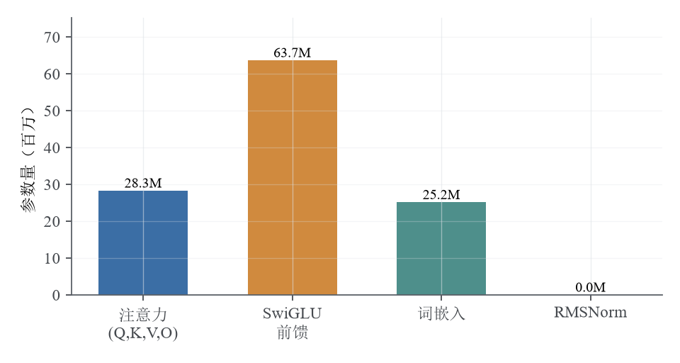
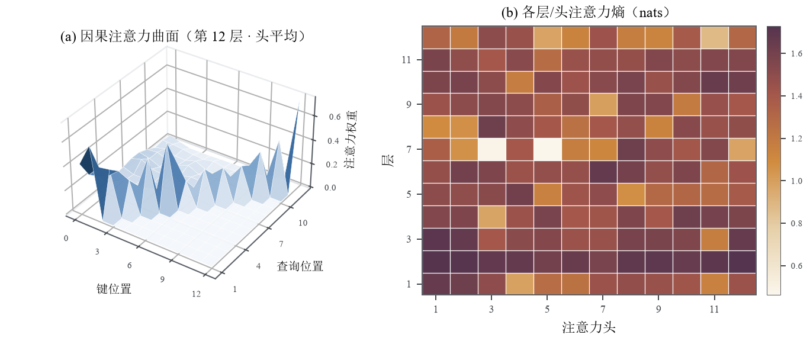
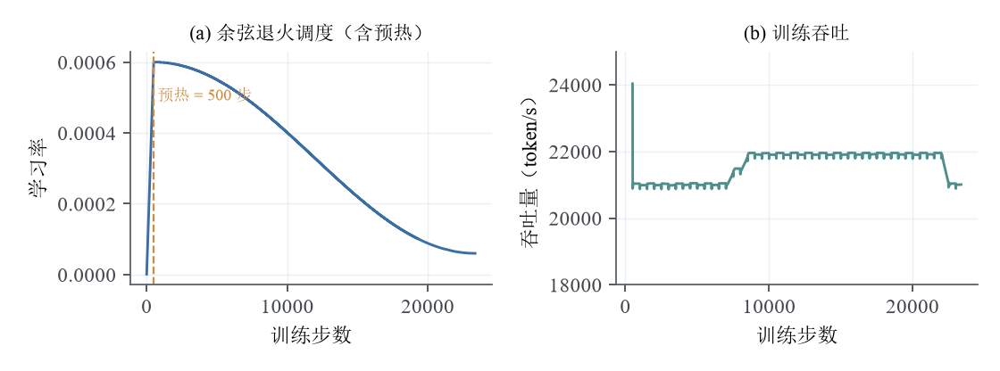
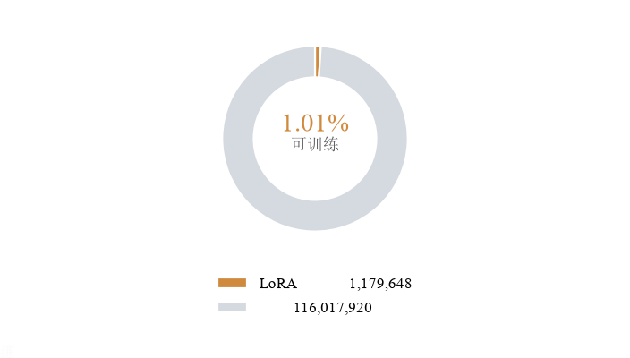
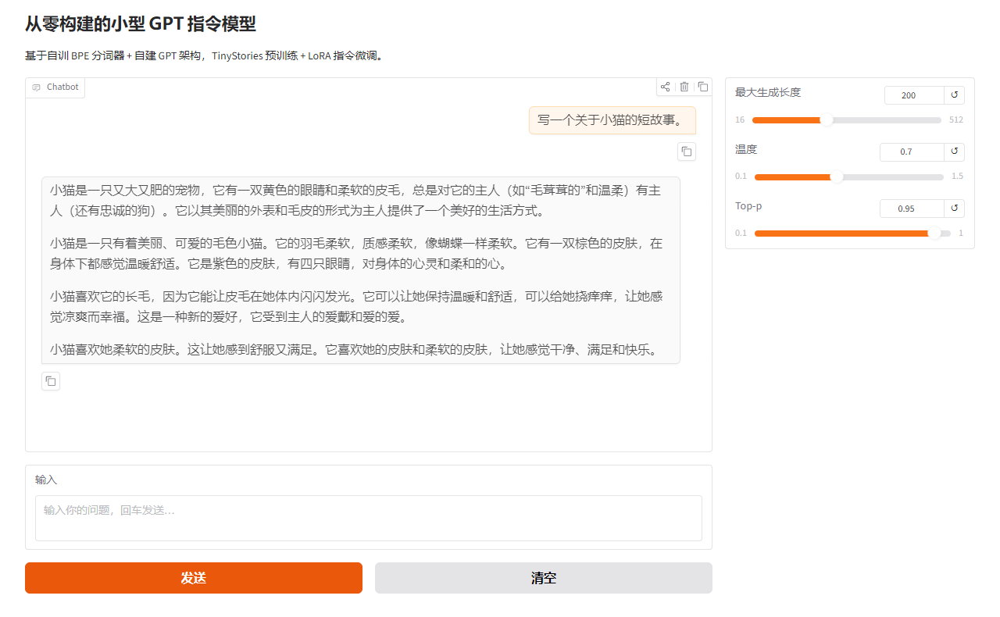

# 从零构建小型 GPT（作业三）

自建 GPT 架构 + 自训中英双语 BPE 分词器 + 预训练 + 从零实现的 LoRA 指令微调
+ 基于 KV 缓存的流式 Web 推理演示。

模型为 12 层、768 维、12 头、上下文 1024 的解码器 GPT，参数量 1.172 亿；
在单张 8 GB 笔记本 GPU 上完成预训练与微调。

## 目录结构

```
repo/
├── gptfs/                  # 核心包
│   ├── config.py           # 模型/训练配置
│   ├── model.py            # GPT（RMSNorm/RoPE/SwiGLU/因果注意力/权重共享）+ KV-Cache
│   ├── tokenizer.py        # 字节级 BPE 分词器训练与封装
│   ├── data.py             # 语料 -> uint16 token bin、随机窗口数据集
│   ├── train.py            # 预训练循环（AMP/梯度累积/余弦退火/检查点）
│   ├── lora.py             # 从零实现的 LoRA
│   ├── sft.py              # 指令微调（loss 掩码 + LoRA/全参）
│   ├── inference.py        # 检查点加载 + 流式生成
│   ├── generate.py         # 采样（温度/top-k/top-p/重复惩罚）
│   └── utils.py            # 学习率调度、日志等
├── scripts/
│   ├── prepare_data.py     # 训练分词器 / 生成 token bin
│   ├── download_data.py    # 断点续传下载（支持 hf-mirror）
│   ├── convert_alpaca.py   # Alpaca JSON -> jsonl
│   ├── evaluate.py         # 验证集困惑度 + 样例生成
│   ├── eval_bits_per_byte.py  # 同文本跨词表 bits/byte 评测
│   ├── eval_story_task.py     # 留出提示的短故事任务评测
│   ├── measure_vram.py        # 单步训练显存拆解
│   ├── benchmark_inference.py # 推理吞吐/延迟/显存基准
│   └── app.py              # Gradio 聊天界面
├── tests/smoke_test.py     # 前向、KV 缓存、LoRA、分词与数据测试
├── artifacts/tokenizer/    # 第一版纯英文分词器（对照）
├── artifacts/tokenizer_bi/ # 中英双语分词器（32,768）
└── docs/figures/           # README 展示用图（来自报告）
```

## 快速开始

```bash
# 0) 环境
python -m venv X:/llm-course/venv
X:/llm-course/venv/Scripts/python.exe -m pip install torch \
    --index-url https://download.pytorch.org/whl/cu128
X:/llm-course/venv/Scripts/pip install -r requirements.txt

# 1) 训练双语分词器（--sample_chars 为每个语料文件的字符预算）
python -m scripts.prepare_data tokenizer \
    --input X:/llm-course/data/raw/en_sample.txt,X:/llm-course/data/raw/zh_sample.txt \
    --out artifacts/tokenizer_bi --vocab_size 32768 --sample_chars 150000000

# 2) 生成 token bin
python -m scripts.prepare_data bins \
    --train_text X:/llm-course/data/raw/bi_train.txt \
    --val_text X:/llm-course/data/raw/bi_val.txt \
    --tokenizer_dir X:/llm-course/repo/artifacts/tokenizer_bi \
    --out_dir X:/llm-course/data/tokenized_bi

# 3) 预训练（约一个数据集规模的 token 预算，23,384 步）
python -m gptfs.train --max_steps 23384 --batch_size 4 --grad_accum 8 \
    --block_size 1024 --n_layer 12 --n_embd 768 --n_head 12 \
    --data_dir X:/llm-course/data/tokenized_bi \
    --tokenizer_dir X:/llm-course/repo/artifacts/tokenizer_bi \
    --out_dir X:/llm-course/checkpoints/pretrain_bi

# 4) 指令微调（LoRA r=16, alpha=32）
python -m gptfs.sft \
    --ckpt X:/llm-course/checkpoints/pretrain_bi/best.pt \
    --tokenizer_dir X:/llm-course/repo/artifacts/tokenizer_bi \
    --train_jsonl X:/llm-course/data/raw/sft/train_768_bi.jsonl \
    --epochs 2 --out_dir X:/llm-course/checkpoints/sft_bi --save_merged

# 5) 评估 / Web 演示
python -m scripts.evaluate --ckpt X:/llm-course/checkpoints/sft_bi/sft_merged.pt \
    --tokenizer_dir X:/llm-course/repo/artifacts/tokenizer_bi \
    --data_dir X:/llm-course/data/tokenized_bi --block_size 1024 --sft
python -m scripts.app --ckpt X:/llm-course/checkpoints/sft_bi/sft_merged.pt \
    --tokenizer_dir X:/llm-course/repo/artifacts/tokenizer_bi
```

## 模型配置

| 项 | 值 |
|---|---|
| 层数 | 12 |
| d_model | 768 |
| 注意力头 | 12（head_dim 64，MHA） |
| FFN | SwiGLU，hidden=2304 |
| 上下文 | 1024 |
| 词表 | 32,768（自训中英双语 BPE） |
| 位置编码 | RoPE（theta=10000） |
| 归一化 | RMSNorm（pre-norm） |
| 权重共享 | 是（token embedding ↔ lm_head） |
| 参数量 | 117,197,568 |

## 结果摘要

- **分词器**：英文压缩率 4.03、中文 2.39 字符/token（纯英文词表下中文仅 0.44）。
- **预训练**：766M token / 23,384 步，验证困惑度 35,671 → 4.69；相同留出文本上
  英文 0.380 bits/char（纯英文版 0.382），中文 1.37 bits/char（纯英文版 43.7）。
- **指令微调**：LoRA 仅训练 1.01% 参数，指令验证集困惑度 200 → 36.0
  （英 22.9 / 中 65.8）；同文本 bits/byte 由 2.317 降至 1.561。
- **短故事任务**（24 条留出提示）：语言匹配 83.3% → 100%，任务成功率 0 → 16.7%。
- **推理**（bf16）：单 token 11–15 ms，吞吐 65–91 token/s，峰值显存 0.27–0.28 GB。

## 图表

### 模型架构与参数




### 预训练





### 指令微调与 LoRA





### 推理与部署


<table>
<tr>
<td></td>
<td></td>
</tr>
</table>

## 参考

Sebastian Raschka, *Build a Large Language Model (From Scratch)*
(https://github.com/rasbt/LLMs-from-scratch)。所有代码按本项目需要重新实现，
并针对中英双语词表、LoRA、KV 缓存与流式部署做了适配。
