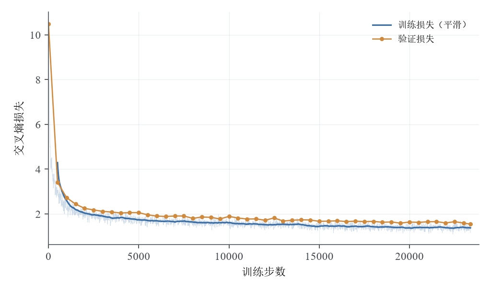
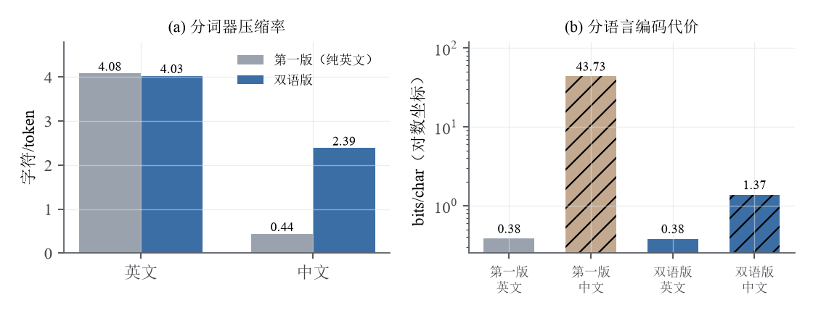
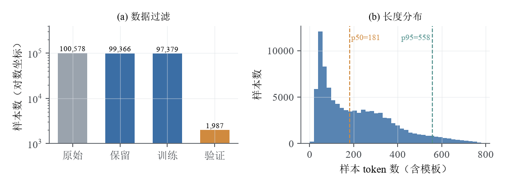
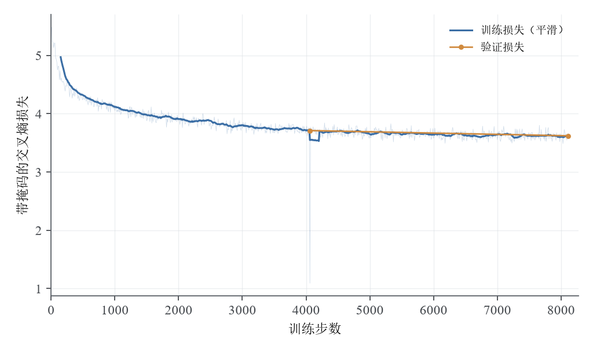
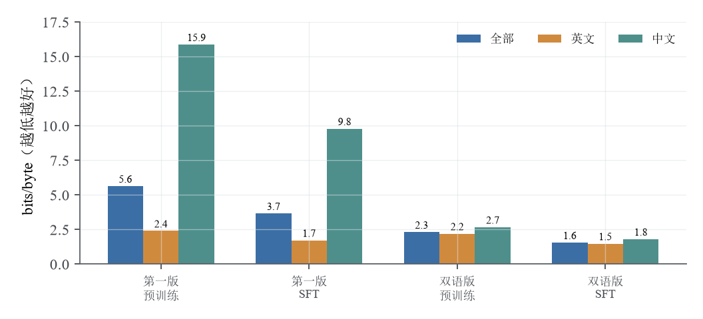
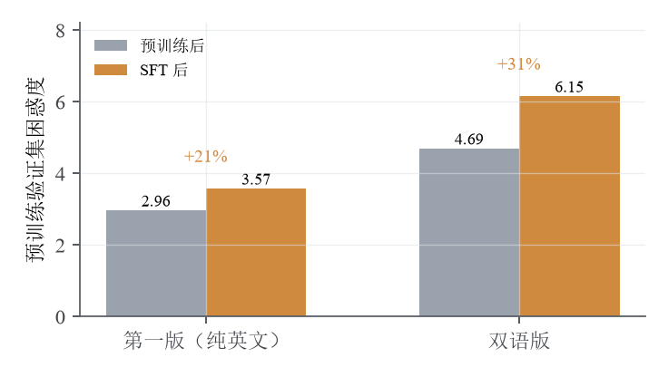
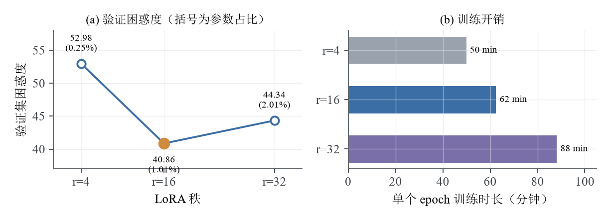
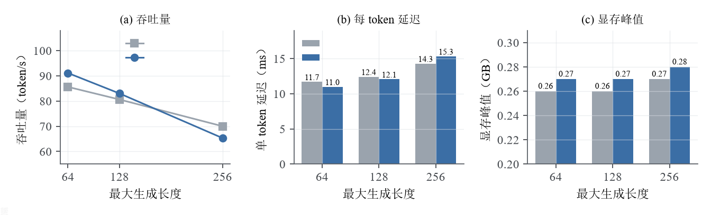
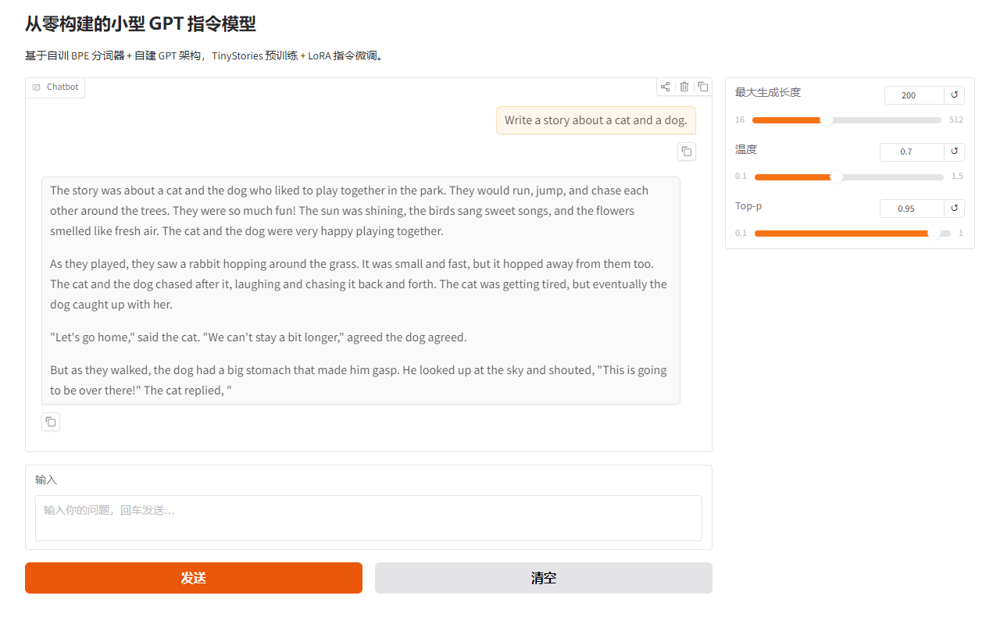

# 从零构建小型 GPT

<p align="center">
  <b>12 层 · 768 维 · 1.17 亿参数 · 中英双语 · 单卡 8 GB 可训练</b>
</p>

<p align="center">
  
  
  
  
</p>

从零实现一个中英双语 GPT 类小语言模型：手写 GPT 架构、自训 BPE 分词器、完成
预训练与 LoRA 指令微调，并用 KV 缓存 + Gradio 做流式对话演示。除公开语料外，
模型结构、训练循环、LoRA、评测和部署代码均在本仓库中。

> 这是一个**教学规模**的项目：目标是把大模型训练链路完整跑通，而不是追求
> 通用能力。模型仍会出现事实错误、重复和语种串扰。

## 项目亮点

| | |
|---|---|
| **从零实现** | RMSNorm、RoPE、因果多头注意力、SwiGLU、权重共享、KV 缓存、LoRA 均由本项目实现 |
| **双语词表** | 在中英各 1.5 亿字符上自训 32,768 词表 BPE，中文压缩率 2.39 字符/token |
| **单卡训练** | RTX 4070 Laptop 8 GB 完成 7.66 亿 token 预训练与 LoRA 微调 |
| **完整评测** | 预训练 PPL、跨词表 bits/char、指令 PPL、实体约束故事任务、模板重合检查 |
| **可交互演示** | Gradio 流式中英对话，bfloat16 下单 token 约 11–15 ms |

## 模型配置

| 项目 | 取值 |
|---|---|
| 结构 | decoder-only Transformer |
| 层数 / 维度 / 头数 | 12 / 768 / 12（head_dim 64，MHA） |
| FFN | SwiGLU，hidden = 2304 |
| 上下文 | 1024 |
| 位置编码 | RoPE，theta = 10000 |
| 归一化 | RMSNorm（pre-norm） |
| 权重共享 | token embedding ↔ lm_head |
| 词表 | 32,768（自训中英双语 BPE） |
| 参数量 | **117,197,568** |

## 结果一览

| 阶段 | 指标 | 结果 |
|---|---|---:|
| 分词器 | 中文压缩率 | **2.39 字符/token**（纯英文词表 0.44） |
| 预训练 | 验证困惑度 | 35,671 → **4.69** |
| 预训练 | 相同留出文本 bits/char | 英文 **0.380**，中文 **1.37** |
| 指令微调 | 指令验证困惑度 | 200 → **36.0**（英 22.9 / 中 65.8） |
| 故事任务 | 独立测试自动约束通过 | **71/144**；与训练模板遮蔽重合 **16.7%** |
| 推理 | bf16 单 token 延迟 | 约 **11–15 ms** |
| 推理 | 吞吐 / 峰值显存 | **65–91 token/s** / **0.28 GB** |

故事任务指标只表示“三实体覆盖 + 语言比例 + 重复度”的自动约束，并**不证明**
要求的事件在故事中实际发生；模板重合也说明结果中包含明显的模板检索成分。

## 快速开始

以下命令假定项目根目录包含 `repo/`、`data/`、`checkpoints/`、`runs/`、`venv/`。
用环境变量表示项目根目录，避免把本机路径写死：

```bash
export PROJECT_ROOT=/path/to/project
cd "$PROJECT_ROOT"
```

Windows 下把 `venv/bin/python` 替换为 `venv/Scripts/python.exe`。

### 1. 环境

```bash
python -m venv venv
venv/bin/python -m pip install torch --index-url https://download.pytorch.org/whl/cu128
venv/bin/pip install -r repo/requirements.txt
```

### 2. 数据与分词器

```bash
cd "$PROJECT_ROOT/repo"

# 中文 TinyStories 合并为文本流（英文直接使用 TinyStoriesV2-GPT4）
python - <<'PY'
import glob, json
with open("../data/raw/zh_train.txt", "w", encoding="utf-8") as f:
    for p in sorted(glob.glob("../data/raw/zh/data*.json")):
        for row in json.load(open(p, encoding="utf-8")):
            f.write(row["story"].replace("<|endoftext|>", "") + "<|endoftext|>\n")
PY

# 训练 32,768 词表 BPE；--sample_chars 为每个语料文件的字符预算
"$PROJECT_ROOT/venv/bin/python" -m scripts.prepare_data tokenizer \
    --input ../data/raw/en_sample.txt,../data/raw/zh_sample.txt \
    --out artifacts/tokenizer_bi --vocab_size 32768 \
    --sample_chars 150000000

# 生成 uint16 token bin
"$PROJECT_ROOT/venv/bin/python" -m scripts.prepare_data bins \
    --train_text ../data/raw/bi_train.txt \
    --val_text ../data/raw/bi_val.txt \
    --tokenizer_dir artifacts/tokenizer_bi \
    --out_dir ../data/tokenized_bi
```

### 3. 预训练

```bash
cd "$PROJECT_ROOT/repo"
"$PROJECT_ROOT/venv/bin/python" -m gptfs.train --max_steps 23384 \
    --batch_size 4 --grad_accum 8 --block_size 1024 \
    --n_layer 12 --n_embd 768 --n_head 12 \
    --data_dir ../data/tokenized_bi \
    --tokenizer_dir artifacts/tokenizer_bi \
    --out_dir ../checkpoints/pretrain_bi
```

### 4. LoRA 指令微调

```bash
cd "$PROJECT_ROOT/repo"
"$PROJECT_ROOT/venv/bin/python" -m gptfs.sft \
    --ckpt ../checkpoints/pretrain_bi/best.pt \
    --tokenizer_dir artifacts/tokenizer_bi \
    --train_jsonl ../data/raw/sft/train_768_bi.jsonl \
    --epochs 2 --out_dir ../checkpoints/sft_bi --save_merged
```

### 5. 评测与演示

```bash
cd "$PROJECT_ROOT/repo"

# 验证集困惑度 + 样例
"$PROJECT_ROOT/venv/bin/python" -m scripts.evaluate \
    --ckpt ../checkpoints/sft_bi/sft_merged.pt \
    --tokenizer_dir artifacts/tokenizer_bi \
    --data_dir ../data/tokenized_bi --block_size 1024 --sft

# Gradio 流式对话
"$PROJECT_ROOT/venv/bin/python" -m scripts.app \
    --ckpt ../checkpoints/sft_bi/sft_merged.pt \
    --tokenizer_dir artifacts/tokenizer_bi
```

> 全参数微调会保存 `sft_model.pt`；LoRA 合并后保存 `sft_merged.pt`，两者不要混用。
> 权重文件较大，未放进仓库，需在本地 `checkpoints/` 下准备。

## 目录结构

```text
repo/
├── gptfs/
│   ├── config.py       # 模型/训练配置
│   ├── model.py        # GPT：RMSNorm / RoPE / 因果注意力 / SwiGLU / KV-Cache
│   ├── tokenizer.py    # 字节级 BPE 训练与封装
│   ├── data.py         # 语料 → uint16 token bin，随机窗口采样
│   ├── train.py        # 预训练：AMP、梯度累积、余弦退火、检查点
│   ├── lora.py         # 从零实现的 LoRA
│   ├── sft.py          # 指令微调：loss mask + LoRA / 全参
│   ├── inference.py    # 检查点加载 + 流式生成
│   ├── generate.py     # 温度 / top-k / top-p / 重复惩罚
│   └── utils.py        # 学习率调度、日志、设备
├── scripts/
│   ├── prepare_data.py       # 分词器训练 / token bin
│   ├── download_data.py      # 断点续传下载
│   ├── convert_alpaca.py     # Alpaca JSON → jsonl
│   ├── evaluate.py           # 验证集 PPL + 样例
│   ├── eval_bits_per_byte.py # 跨词表 bits/byte
│   ├── eval_story_task.py    # 留出提示故事任务
│   ├── measure_vram.py       # 单步显存拆解
│   ├── benchmark_inference.py# 推理延迟 / 吞吐 / 显存
│   └── app.py                # Gradio 聊天界面
├── tests/smoke_test.py # 前向、KV、LoRA、分词与数据测试
├── artifacts/tokenizer/    # 第一版纯英文分词器（对照）
├── artifacts/tokenizer_bi/ # 双语 32,768 词表
└── docs/figures/           # README 与报告图表
```

## 图表

### 架构与参数

<p align="center">
  
  
</p>

### 预训练

<p align="center">
  
  
</p>

<p align="center">
  
</p>

### 指令微调与 LoRA

<p align="center">
  
  
</p>

<p align="center">
  
  
</p>

<p align="center">
  
  
</p>

### 推理与演示

<p align="center">
  
</p>

<table>
<tr>
<td align="center"><br>中文对话</td>
<td align="center"><br>English chat</td>
</tr>
</table>

## 实验记录与边界

- **KV 缓存**：数值一致性通过；但在本 1.17 亿模型 / RTX 4070 Laptop / bf16 /
  单请求下，cache on/off 墙钟比为 0.93–1.04×，没有稳定加速，仅峰值显存更低。
- **故事任务**：任务数据在独立测试上自动约束通过 71/144，但与训练模板的实体
  遮蔽 8-gram 重合约 16.7%；提升主要来自模板检索和实体替换，不能称为原创故事
  能力或情节组合泛化。
- **数据质量 pilot**：严格核验后仅得到 190 条可用自然数据，开发集未通过；这是一
  次数据受限实验，不能据此断言“自然数据无效”。
- **全参数微调**：8 GB 显存可运行，但模板重合高，默认仍使用 LoRA。
- 完整逐条输出、日志、人工/助手复核和失败记录保存在实验机的 `runs/` 目录，
  未随代码仓库发布。

## 已知限制

- 1.17 亿参数、7.66 亿 token 的预算有限，世界知识和长程推理能力弱；
- 中文回答可能夹带英文碎片，事实性问题可能生成流畅但错误的答案；
- 生成仍有重复、模板化和提前结束；
- 任务评测不能替代独立人工评估，模板重合高时尤其要谨慎解读。

## 参考

Sebastian Raschka, *Build a Large Language Model (From Scratch)*
(https://github.com/rasbt/LLMs-from-scratch)。本项目的代码按自己的理解重新实现，
并针对中英双语词表、LoRA、KV 缓存与流式部署做了适配。
